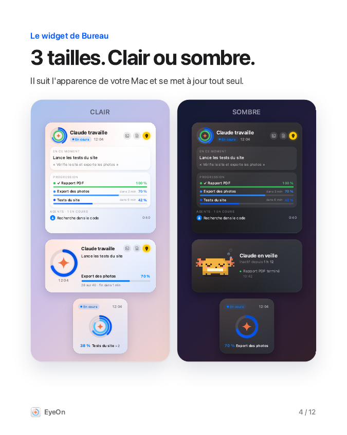
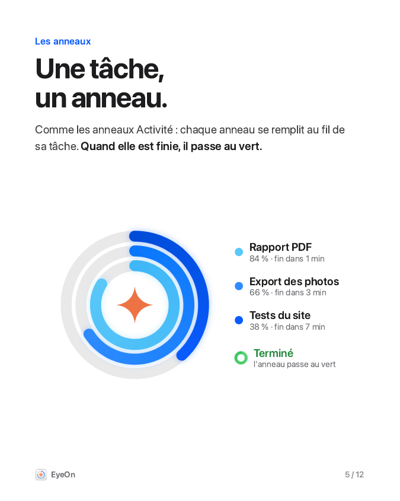

# EyeOn

**Suis en direct ce que fait Claude Code, depuis la barre des menus et le Bureau de ton Mac.**

EyeOn est une petite app macOS gratuite et open source. Pendant que Claude Code travaille dans ton terminal, EyeOn affiche ce qu'il fait, l'avancement de ses étapes et de ses agents, et te prévient quand c'est fini — sans que tu aies besoin de surveiller la fenêtre.

> EyeOn est un projet indépendant, compatible avec Claude Code. Il n'est ni affilié à Anthropic ni approuvé par Anthropic.

<p align="center">
  
  
  
</p>

**[⬇︎ Télécharger EyeOn (.dmg)](https://github.com/FullFireZoo/EyeOn/releases/latest)**

## Ce que fait EyeOn

- **Barre des menus** : l'icône ✦ ouvre un panneau avec la demande en cours, l'action en cours, les barres de progression, les agents, l'historique récent, le résumé de la journée et la jauge de mémoire (contexte) de Claude.
- **Widget de Bureau** (petit, moyen, grand) : des anneaux de progression emboîtés, façon anneaux Activité — un anneau par tâche, en dégradé de bleus, qui passe au vert quand la tâche est finie. En veille, la mascotte d'EyeOn (un petit axolotl doré en pixel art) dort en faisant des bulles.
- **Alertes intelligentes** : notification quand une longue tâche est terminée ou quand Claude t'attend. EyeOn attend que ton micro soit libre (dictée), reste discret pendant une vidéo ou en mode Ne pas déranger, et ne dit rien si tu es déjà dans le terminal de Claude.
- **Alerte iPhone (facultatif)** : si tu n'es pas devant ton Mac, un iMessage t'est envoyé (à toi-même).
- **Ampoule** : garde l'écran allumé tant que Claude travaille.
- **⌥ Espace** ouvre le panneau depuis n'importe où.
- **Boutons rapides** : revenir au terminal, ouvrir le dernier fichier modifié ou son dossier.
- **Barres pour tes propres scripts** avec l'outil `eyeon-progres` (voir plus bas).

## Installation

1. Télécharge `EyeOn-<version>.dmg` depuis la page **Releases** de ce dépôt.
2. Ouvre le fichier `.dmg` et **glisse EyeOn dans le dossier Applications**.
3. **La première fois** : dans Applications, fais **clic droit sur EyeOn → Ouvrir**, puis confirme **Ouvrir**.
   EyeOn n'est pas signé avec un compte développeur Apple payant ; macOS demande donc cette confirmation une seule fois.
   Si macOS bloque quand même : Réglages Système → Confidentialité et sécurité → en bas, « Ouvrir quand même ».
4. L'assistant de démarrage s'ouvre : clique sur **Connecter à Claude Code**, puis laisse-toi guider.
5. Pour ajouter le widget : clic droit sur le Bureau → **Modifier les widgets** → cherche « EyeOn ».

Les sessions de Claude Code déjà ouvertes prennent en compte EyeOn à leur prochain démarrage.

## Autorisations, et pourquoi

| Autorisation | Obligatoire ? | Pourquoi |
|---|---|---|
| Hooks de Claude Code (`~/.claude/settings.json`) | Oui | Claude Code prévient EyeOn à chaque étape. Une copie de sécurité horodatée du fichier est faite avant chaque modification, et tes autres réglages ne sont pas touchés. |
| Notifications | Recommandée | Pour te prévenir quand une tâche est finie ou quand Claude t'attend. |
| Accès complet au disque | Facultatif | Uniquement pour savoir si Ne pas déranger / une Concentration est active (macOS protège ce réglage). Sans cet accès, tout le reste fonctionne. |
| Automatisation de Messages | Facultatif | Seulement si tu actives l'alerte iPhone. |
| Ouverture de session | Facultatif | Pour qu'EyeOn démarre avec ton Mac. |

## Confidentialité

**Tout reste sur ton Mac. EyeOn n'envoie rien, à personne** : pas de compte, pas de statistiques, pas de serveur.
Les données (état, barres, résumé du jour) sont stockées dans `~/Library/Application Support/EyeOn/`.
EyeOn lit la fin du journal de conversation de Claude Code uniquement pour calculer la jauge de mémoire, sur ton Mac.
La seule chose qui peut sortir de ton Mac est l'iMessage d'alerte, si tu l'actives, envoyé par ta propre app Messages.

## Barres de progression pour tes scripts

```bash
EYEON="/Applications/EyeOn.app/Contents/MacOS/eyeon-progres"
"$EYEON" export "Export des photos" 12 40 "IMG_0012.jpg"   # <id> "<titre>" <fait> <total> [détail]
"$EYEON" fin export                                        # termine la barre
"$EYEON" demo                                              # barre de démonstration (20 s)
```

## Désinstallation

1. Panneau ✦ → Réglages → **Réglages d’EyeOn…** → **Désinstaller…**
   Cela retire les hooks EyeOn de Claude Code (et rien d'autre), désactive l'ouverture de session et peut effacer les données d'EyeOn.
2. Mets EyeOn.app à la corbeille et retire le widget du Bureau.

En ligne de commande : `/Applications/EyeOn.app/Contents/MacOS/EyeOn --deconnecter`

## Compatibilité

- macOS 14 Sonoma ou plus récent, Mac Apple (M1 et suivants) ou Intel (app universelle).
- Claude Code (hooks `UserPromptSubmit`, `PreToolUse`, `SubagentStart`, `SubagentStop`, `Stop`, `SessionEnd`, `PreCompact`, `TaskCreated`, `TaskCompleted`).
- Le terminal qui héberge Claude Code est détecté automatiquement (Terminal, iTerm2, Ghostty, Warp…).

## Construire depuis les sources

Seuls les outils en ligne de commande d'Apple sont nécessaires (`xcode-select --install`), pas Xcode.

```bash
./build.sh               # → dist/EyeOn.app et dist/EyeOn-<version>.dmg (signature ad hoc)
./build.sh --installer   # construit, copie dans /Applications et enregistre le widget
```

Organisation : `Sources/App` (app de la barre des menus, assistant, réglages), `Sources/Widget` (widget WidgetKit),
`Sources/Hook` (`eyeon-hook`, appelé par Claude Code), `Sources/Progres` (`eyeon-progres`), `Sources/Commun` (code partagé),
`Resources/panneau.html` (panneau), `design/` (référence de la mascotte ; `design/outils/apercus.sh` rend des aperçus PNG du widget et du panneau sans lancer l'app). Pour les tests, la variable `EYEON_DATA` redirige le dossier de données
et `EyeOn --connecter <fichier>` / `--deconnecter <fichier>` agit sur un fichier de réglages précis.

## Licence

MIT — voir [LICENSE](LICENSE).

---

## English

**See what Claude Code is doing, live, from your Mac's menu bar and desktop.**

EyeOn is a small, free and open-source macOS app. While Claude Code works in your terminal, EyeOn shows its current action, step progress and sub-agents, and lets you know when it's done.

> EyeOn is an independent project compatible with Claude Code. It is not affiliated with or endorsed by Anthropic. The interface is in French.

*Screenshots coming soon.*

### Features
Menu bar panel (current request and action, progress bars, agents, daily summary, context-memory gauge) · desktop widget with nested progress rings · smart notifications (waits while your microphone is in use, quiet during videos or Do Not Disturb, silent if you're already in Claude's terminal) · optional iMessage alert when you're away · keep-awake bulb · ⌥ Space shortcut · `eyeon-progres` CLI for your own scripts.

### Install
1. Download `EyeOn-<version>.dmg` from **Releases**.
2. Drag EyeOn into **Applications**.
3. First launch: **right-click EyeOn → Open**, then confirm (the app is ad-hoc signed, not notarized).
   If macOS still blocks it: System Settings → Privacy & Security → scroll down → **Open Anyway**.
4. In the welcome assistant, click **Connect to Claude Code** (« Connecter à Claude Code »).
5. Add the widget: right-click the desktop → Edit Widgets → “EyeOn”.

### Permissions
Claude Code hooks in `~/.claude/settings.json` (required; a timestamped backup is made and other settings are preserved) · Notifications (recommended) · Full Disk Access (optional, only to detect Do Not Disturb / Focus) · Messages automation (optional, iPhone alert) · Login item (optional).

### Privacy
Everything stays on your Mac. EyeOn sends nothing anywhere: no account, no analytics, no server. Data lives in `~/Library/Application Support/EyeOn/`.

### Uninstall
Menu bar panel → Réglages → « Réglages d’EyeOn… » → « Désinstaller… » (removes only EyeOn's hooks and the login item), then move the app to the Trash.

### Compatibility
macOS 14+ (universal: Apple silicon and Intel) · Claude Code.

### Build
`./build.sh` (Apple Command Line Tools only, no Xcode).

### License
MIT.
